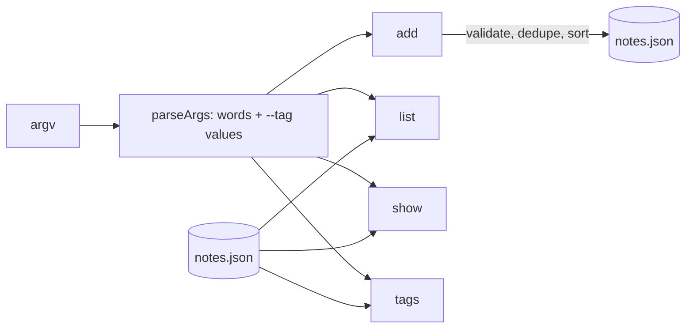

# note-tags — spec
> md · no ticket

## Idea

**Why.** Notes in the `notes` CLI are a flat list today; the person keeping them has no way to group
them or pull out the ones about one subject. Tags give each note a few lower-case labels, a filtered
list, and a summary of which tags are in use.

**What success looks like.** `notes add buy milk --tag home --tag shop` stores the note with both
tags; `notes list` shows `1  buy milk #home #shop` while untagged notes print exactly as before;
`notes list --tag home` shows only the home notes; `notes show 1` prints the text and then
`tags: home, shop`; `notes tags` prints `home  1` and `shop  1`; `notes add x --tag Bad` fails with
exit 1 and a message on stderr; a notes file written before this feature still loads and lists
unchanged. `npm test` is green on `main`.

**In your words.**
- "`notes add <text> --tag <t>` stores the note with that tag; `--tag` may be given more than once." → D2, D6, D8
- "A tag is one word, lower-case letters, digits and dashes." → D4
- "`notes list` is unchanged for untagged notes; a tagged note's line ends with its tags as ` #t1 #t2` (sorted, space before each `#`)." → D9
- "`notes list --tag <t>` shows only notes carrying that tag, in id order." → D10, D11
- "`notes show <id>` prints the text on the first line and, when the note has tags, `tags: t1, t2` (sorted) on the second." → D12
- "`notes tags` lists every tag in use with its count, one per line as `<tag>  <count>`, sorted by tag. With no tags at all it prints nothing." → D13
- "An invalid tag (anything but lower-case letters, digits and dashes) makes `notes add` fail with exit 1 and a message on stderr." → D5
- "Existing notes files without tags keep working." → D2, D3
- "The CLI entry stays `src/cli.mjs`, the tests stay under `test/` and run with `npm test`, and there are still no dependencies." → D15, D17

**The concept.** Each note may carry an optional `tags` array, kept sorted and de-duplicated when it
is written. `add` learns a `--tag <t>` option that can appear anywhere and repeat; `list` appends
` #t` per tag and learns a single `--tag <t>` filter; `show` adds a `tags:` line; a new `tags`
command counts notes per tag. A note without `tags` — every note in an old file — reads as having no
tags.

**How it fits today.** `src/cli.mjs` loads the whole JSON store, switches on the command, and saves
the whole store back[^1]. The store is `{ nextId, notes: [{ id, text }] }`, empty when the file is
missing[^2]. `add` joins all remaining arguments into the text[^3], so today `--tag` would be stored
as literal text. Bad input goes through `fail()` — stderr, exit 1[^4]. The tests run the real CLI
end to end against a temp `NOTES_FILE`[^5]. `fail()`, `find()`, `load()`/`save()` and the test
harness are reused, not rebuilt.

**Approaches considered.** No real fork. Chosen: extend `src/cli.mjs` in place with a small argument
parser and a `tags` case; the store module is unchanged apart from its shape comment. Rejected: a
separate tag index in the store (two sources of truth that `rm` would have to keep in step).

[^1]: src/cli.mjs:11-41
[^2]: src/store.mjs:5-9
[^3]: src/cli.mjs:14
[^4]: src/cli.mjs:5-8
[^5]: test/cli.test.mjs:10-13

## Apps

| App | In scope | What changes | Section |
|---|---|---|---|
| notes | ✅ | `--tag` on `add` and `list`, a `tags:` line on `show`, a new `tags` command, an optional `tags` field on stored notes | §notes |

**Sequencing:** single app — contract, then implementation and tests in one phase.

**Backward compatibility:** no app is a released artifact. Old notes files have no `tags` key and
read as untagged (D3); untagged notes are written without a `tags` key (D2), so their stored shape
and their `list` / `show` output are byte-identical to today.

**Blast radius:** only `src/cli.mjs` reads the store; nothing else consumes `notes.json`.

## Decisions

<!-- The one place rulings live. Record the DECISION — and, in one line, why, and why the rejected option lost. A stated preference
     is the INPUT to a row, not the row. Write each Ruling as something later code can be checked
     against without re-interpretation:
       · positive and specific — "store the full number, mask at render", not "don't truncate"
       · scope named — which apps, screens or endpoints it binds
       · "etc." / "and so on" expanded into the list, or the test for membership stated
       · the rejected alternative named, with the reason it lost (check-obligations warns on a bare one)
       · the enforcement hook, where one exists (lint rule, script, test)
     🔴 NEVER quote the user's prompt as the ruling. Operationalize it: a closed list, a measured
     value, an enumerated set of deviations. A ruling a stranger could implement two ways is not
     written yet.
     Who/date carries the provenance, so the Ruling itself needs no quote marks.
     The owner's own words go in §Idea "In your words", linked to this row — never in the Ruling.
     OPEN rows block the build go-ahead. Never delete a ruling; supersede it in place with a date. -->

| # | Decision | Ruling | Who / date |
|---|---|---|---|
| D1 | Apps | Only the `notes` app (the repo's single app) changes. | (assumed at brainstorm) |
| D2 | Storage shape | A tagged note is stored as `{ id, text, tags }` where `tags` is a non-empty array of strings, sorted ascending (default JS string order) and de-duplicated at write time; a note with no tags is stored as `{ id, text }` with no `tags` key. Why: untagged notes stay byte-identical to today and every reader can print `tags` as stored. Rejected: `tags: []` on every note — changes the shape of every note for nothing; a top-level tag→ids index — a second source of truth that `rm` must keep in step. | auto (recommended) 2026-10-23 |
| D3 | Old files | Every reader treats a missing `tags` key as no tags (`note.tags ?? []`); `load()` performs no migration and nothing is rewritten on read. Why: old files keep working with zero risk. Rejected: a load-time migration — writes files on a read-only command. | auto (recommended) 2026-10-23 |
| D4 | Tag validity | A tag is valid iff it matches `/^[a-z0-9-]+$/` (one or more lower-case ASCII letters, digits or dashes). Input is never lower-cased or trimmed for the user: `Work`, `a b`, `a_b`, `#a` and the empty string are invalid. Why: the brief's rule taken literally. Rejected: auto-lower-casing — the brief calls such input invalid and silent fixing hides mistakes. | auto (recommended) 2026-10-23 |
| D5 | Invalid tag on `add` | `notes add` with any invalid tag prints `invalid tag: <t>` on stderr, exits 1, prints nothing on stdout and does not write the store (nextId unchanged). Why: the brief requires exit 1 + stderr; a failed command has no side effect. Rejected: storing the note without the bad tag — silent data loss. | auto (recommended) 2026-10-23 |
| D6 | `--tag` parsing on `add` | After `add`, each `--tag` consumes the next argument as a tag value; it may appear anywhere and any number of times. Every other argument is a text word; the text is the words joined by single spaces and trimmed, as today. A `--tag` with no following argument fails with the usage message (stderr, exit 1). Why: both `add --tag home buy milk` and `add buy milk --tag home` work. Rejected: flags only at the end — brittle; a `--tag=t` form — not asked for. | auto (recommended) 2026-10-23 |
| D7 | Text required | `add` with tags but no text fails with the usage message (stderr, exit 1), as an empty `add` does today. Why: a note always has text to list and show. Rejected: tag-only notes — a line with nothing to show. | auto (recommended) 2026-10-23 |
| D8 | Duplicate tags | `add x --tag a --tag a` stores `tags: ["a"]`. Why: tags are a set; `notes tags` counts notes, not mentions. Rejected: keeping duplicates — prints `#a #a` and double-counts. | auto (recommended) 2026-10-23 |
| D9 | `list` line format | An untagged note prints `<id>  <text>` (two spaces) exactly as today; a tagged note prints `<id>  <text>` followed by ` #<tag>` for each tag in sorted order, e.g. `3  buy milk #home #shop`. Notes print in id order (store order). An empty store prints an empty line, as today. Why: the brief's format; existing output unchanged. Rejected: a separate tags column — not what was asked. | auto (recommended) 2026-10-23 |
| D10 | `list --tag <t>` | Prints, in the D9 line format, only the notes whose tags include `<t>`, in id order. No matching note (including a valid tag nobody uses) prints nothing and exits 0. An invalid `<t>` (D4) fails with `invalid tag: <t>` on stderr, exit 1; `--tag` with no value fails with the usage message, exit 1. Why: an empty answer is not an error; malformed input is (§Global constraints). Rejected: failing on no match — a valid query with an empty answer is not an error. | auto (recommended) 2026-10-23 |
| D11 | One filter only | `list` accepts at most one `--tag`; a second `--tag`, or any other argument after `list`, fails with the usage message, exit 1. Why: the brief defines a single filter. Rejected: AND or OR across several tags — product behaviour nobody decided. | auto (recommended) 2026-10-23 |
| D12 | `show` format | `show <id>` prints the text on line 1; when the note has tags, line 2 is `tags: ` followed by the sorted tags joined by `, ` (e.g. `tags: home, shop`); an untagged note prints only line 1, exactly as today. Why: the brief's format. Rejected: always printing a `tags:` line — changes output for untagged notes. | auto (recommended) 2026-10-23 |
| D13 | `notes tags` | Prints one line per distinct tag across all notes, `<tag>  <count>` (two spaces), where count is the number of notes carrying that tag, sorted ascending by tag (default JS string order); with no tags in use it prints nothing (empty stdout) and exits 0. A removed note no longer counts. Extra arguments fail with the usage message. Why: the brief's format; counting notes follows from D8. Rejected: sorting by count — the brief says by tag. | auto (recommended) 2026-10-23 |
| D14 | Usage text | `USAGE` becomes `usage: notes add <text> [--tag <t>]... \| list [--tag <t>] \| show <id> \| rm <id> \| tags`. Why: names the new forms and still starts `usage: notes`, which the existing test matches. Rejected: leaving it unchanged — hides the new command. | auto (recommended) 2026-10-23 |
| D15 | Tests | New end-to-end tests live in `test/tags.test.mjs`, using the same `execFileSync` + temp `NOTES_FILE` harness as `test/cli.test.mjs`, covering every row of §Testing; the existing tests stay unchanged and green. Why: `npm test` globs `test/*.test.mjs`; the CLI's contract is its output. Rejected: unit tests of internals — the output is the contract. | auto (recommended) 2026-10-23 |
| D16 | Docs | `README.md`'s command line names `--tag` on `add` and `list` and the `tags` command. Why: the README lists every command today. Rejected: no README change — it would go stale. | auto (recommended) 2026-10-23 |
| D17 | No dependencies | No `dependencies` or `devDependencies` are added to `package.json`; argument parsing is hand-written (not `node:util` `parseArgs`, whose positional/option mixing would need `allowPositionals` and still reject unknown flags differently). Why: §Global constraints; a ten-line loop is clearer. Rejected: `util.parseArgs` — workable but changes how stray `--x` words in note text behave. | (assumed at spec) 2026-10-23 |

## Contract

The CLI's command surface (stdout / stderr / exit code), consumed by the person at the terminal and
by the end-to-end tests.

| Contract | Producer | Consumers | Auth | Request | Response | Errors |
|---|---|---|---|---|---|---|
| `notes add <words…> [--tag <t>]…` | notes (`src/cli.mjs`) | CLI user, `test/tags.test.mjs` | none | words + repeatable `--tag` | stdout: new id | invalid tag → `invalid tag: <t>`, exit 1, nothing stored; no text or dangling `--tag` → usage, exit 1 |
| `notes list [--tag <t>]` | notes (`src/cli.mjs`) | CLI user, `test/tags.test.mjs` | none | optional single tag filter | stdout: `<id>  <text>[ #t…]` per note, id order | invalid tag → `invalid tag: <t>`, exit 1; second `--tag`, stray arg or dangling `--tag` → usage, exit 1 |
| `notes show <id>` | notes (`src/cli.mjs`) | CLI user, `test/tags.test.mjs` | none | id | stdout: text; then `tags: t1, t2` when tagged | `no note <id>`, exit 1 (unchanged) |
| `notes tags` | notes (`src/cli.mjs`) | CLI user, `test/tags.test.mjs` | none | — | stdout: `<tag>  <count>` per tag, sorted; empty when none | extra args → usage, exit 1 |
| notes file `{ nextId, notes: [{ id, text, tags? }] }` | notes (`src/store.mjs` save) | notes (`src/cli.mjs` readers) | — | — | `tags` optional, sorted, unique, non-empty when present | — |

## Schema & API changes

| # | ADD/EDIT/RENAME/REMOVE | Model.field | Wire | Reason | Status |
|---|---|---|---|---|---|
| SC1 | ADD | note.tags | optional `string[]` in `notes.json`, sorted, unique, omitted when empty | tags on notes (D2) | planned |
| SC2 | ADD | CLI `notes tags` command; `--tag` option on `add` and `list` | stdout lines per §Contract | the brief (D6, D10, D13) | planned |

**Data plan:** additive and optional — no backfill. Existing notes have no `tags` key and read as
untagged (D3); nothing rewrites them.

## notes

- `src/cli.mjs`
  - `USAGE` per D14.
  - A small parser over `args`: collect `--tag` values (each must be followed by a value, else
    `fail(USAGE)`) and the remaining words.
  - `isTag = (t) => /^[a-z0-9-]+$/.test(t)`; an invalid one → `fail(\`invalid tag: ${t}\`)` before
    anything is saved.
  - `add`: text from words (D6, D7); tags validated (D5), de-duplicated and sorted (D2, D8); the
    `tags` key set only when non-empty.
  - A `line(note)` helper: `` `${id}  ${text}` `` plus `` ` #${t}` `` per tag (D9); `list` uses it,
    filtered by the single optional tag (D10, D11).
  - `show`: the text, then `tags: …` when tagged (D12).
  - `tags`: count notes per tag, sort by tag, print `<tag>  <count>`; nothing when none (D13).
  - Every reader uses `note.tags ?? []` (D3).
- `src/store.mjs` — the shape comment becomes `{ nextId, notes: [{ id, text, tags? }] }`; no code
  change.
- `README.md` per D16.

## Testing

**notes — `test/tags.test.mjs`** (run by `npm test`), each test against a fresh temp `NOTES_FILE`:

1. `add buy milk --tag shop --tag home` prints `1`; `list` prints `1  buy milk #home #shop`.
2. Mixed list: an untagged note prints `<id>  <text>` unchanged beside tagged ones.
3. `--tag` before the text works: `add --tag home buy milk` stores text `buy milk`.
4. Duplicate `--tag a --tag a` → `list` shows `#a` once; `tags` prints `a  1`.
5. `list --tag home` shows only notes with `home`, in id order; an unused valid tag prints nothing, exit 0.
6. `list --tag Bad` fails exit 1 with `invalid tag` on stderr; `list --tag a --tag b` fails with usage.
7. `show <id>` of a tagged note prints `text\ntags: home, shop`; of an untagged note prints only the text.
8. `tags` prints `home  2\nshop  1` style lines sorted by tag; with no tags (empty store, or only untagged notes) prints nothing; after `rm` of a tagged note its count drops / tag disappears.
9. `add x --tag Work`, `--tag a_b`, `--tag ""` each fail exit 1 with `invalid tag` on stderr, and `list` afterwards shows nothing was stored (and the next successful add still gets id 1).
10. `add --tag home` (no text) and `add x --tag` (dangling) fail with the usage message, exit 1.
11. Old file: a `NOTES_FILE` pre-written as `{ "nextId": 3, "notes": [{ "id": 1, "text": "a" }, { "id": 2, "text": "b" }] }` lists `1  a\n2  b`, shows `a`, `tags` prints nothing, and a tagged add gets id 3.
12. Stored shape: after an untagged add the file's note has no `tags` key; after a tagged add `tags` is the sorted unique array.

The existing `test/cli.test.mjs` stays unchanged and green.

**Human-verification script** (run with `NOTES_FILE=$(mktemp -d)/n.json`):
`node src/cli.mjs add buy milk --tag shop --tag home` → `1` · `node src/cli.mjs add call mum` → `2` ·
`list` → `1  buy milk #home #shop` / `2  call mum` · `list --tag home` → line 1 only · `show 1` →
`buy milk` / `tags: home, shop` · `tags` → `home  1` / `shop  1` · `add x --tag Bad; echo $?` →
`invalid tag: Bad` on stderr, `1`.

## Out of scope

- Removing or editing tags on an existing note (no `untag` / `retag` command).
- Filtering by several tags (AND/OR), or excluding a tag (D11).
- Renaming a tag across notes; tag colours, descriptions or hierarchies.
- A `--tag=t` syntax.

## Findings & risks

| # | Finding | Resolution |
|---|---|---|
| F1 | stale-spec: footnotes [^1], [^3], [^4] pointed at lines that do not exist in the 38-line `src/cli.mjs` | corrected in place |
| F2 | build-time risk: `list --tag a --tag Bad` hits both D10 and D11 — which message wins is settled by Task 2 | Task 2 rules it; both exit 1 on stderr |
