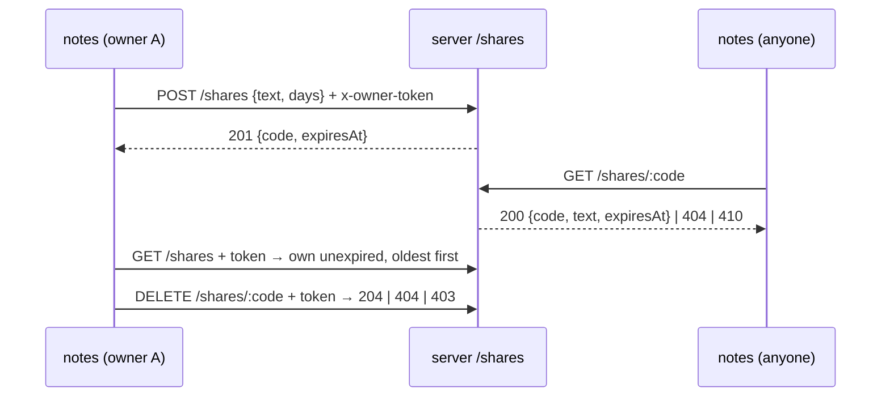

# note-sharing — spec
> md · ticket none

## Idea

**Why.** Notes live in one person's local file; there is no way to hand one to someone else. This
lets a `notes` user share a note through the server as a short code that anyone can use to pull a
copy into their own notes, for a limited time, while the person who shared it can see and withdraw
their shares.

**What success looks like.** `notes share 3` prints an 8-character code. Someone else, with a
different notes file, runs `notes fetch <code>` and gets a new local note with the same text. After
the share's days run out, the fetch fails saying it has expired. `notes shares` lists what you have
shared and when each expires, and `notes unshare <code>` withdraws one. The four routes are covered
end to end in the server's suite, the four commands in the CLI's, and `npm test` is green on `main`.

**In your words.**
- "share a note, get a short code, and anyone with the code can fetch a copy of it until it expires." → D2, D10, D24
- "8 characters, lower-case letters and digits, unique." → D3
- "Every share has an owner. A request names its owner with the `x-owner-token` header; any non-empty string is a token. Creating, listing and deleting shares need it (401 without it); fetching one by its code does not." → D7, D8
- "`days` is a whole number from 1 to 30 and defaults to 7" → D5, D6
- "410 once the share has expired (the current time is at or past `expiresAt`)" → D9
- "When `NOTES_NOW` is set (an ISO 8601 timestamp) the server takes it as the current time — that is how expiry gets tested." → D13
- "Its owner token is made on first use and kept in the notes file, so a different `NOTES_FILE` is a different owner. Existing notes files keep working." → D16
- "`notes share <id> [--days <n>]` shares the note's text and prints only the code." → D17
- "`<code>  <YYYY-MM-DD>  <text>`, the date being the UTC day of `expiresAt`. With none it prints nothing." → D19
- "Every failure exits 1 with a one-line message on stderr." → D15
- "there are still no dependencies." → D29

**The concept.** The server gains a `shares` collection and four routes under `/shares`. The CLI
gains an owner token stored in its notes file, a small `fetch`-based client pointed at
`NOTES_SERVER`, and four commands that call those routes.

**How it fits today.** The server is a `node:http` JSON API whose routes are a table in
`createApp`¹; handlers return `[status, body]` or throw `HttpError`, answered as `{ "error" }`². Data
goes through `createStore`³, which persists to `STORE_FILE` — so shares survive a restart for free.
Time comes from an injectable `now`, but the entry point creates the app without one⁴, so `NOTES_NOW`
is wired there. The CLI is one `switch` over commands⁵ on a local JSON file `{ nextId, notes }`⁶; it
has never talked to the server. Node's global `fetch` gives it an HTTP client without a dependency.

¹ `apps/server/src/app.mjs:8` · ² `apps/server/src/app.mjs:47` · ³ `apps/server/src/store.mjs:8` ·
⁴ `apps/server/src/server.mjs:7` · ⁵ `apps/cli/src/cli.mjs:12` · ⁶ `apps/cli/src/store.mjs:6`

**Approaches considered.** No real fork: the brief fixes the contract and the house rules fix where
each part lives. Chosen: server phase (store collection, routes, `NOTES_NOW`) → contract frozen →
CLI phase (token, client, commands). Rejected: a shared client module in `test-support/` or a CLI
that imports server code — it couples two apps the config keeps apart.

## Apps

| App | In scope | What changes | Section |
|---|---|---|---|
| server | ✅ | `shares` store collection; `POST /shares`, `GET /shares`, `GET /shares/:code`, `DELETE /shares/:code`; `NOTES_NOW` as the app's `now` | §server |
| cli | ✅ | owner token in the notes file; `NOTES_SERVER` client; `share`, `fetch`, `shares`, `unshare` commands | §cli |

**Sequencing:** contract settled → server implements and verifies (contract FREEZES) → cli builds
against the frozen contract → the cross-app E2E walk.

**Backward compatibility:** no app is a released artifact; both ship together from `main`. The
change is additive: existing `/notes` routes and `add/list/show/rm` are unchanged, and notes files
without `ownerToken` load and work as before (D16).

**Blast radius:** the server's store file gains a `shares` key (new collection, nothing existing
reads it). The CLI's notes file gains an optional `ownerToken` key; only the new commands read it.

## Decisions

<!-- The one place rulings live. Record the DECISION — and, in one line, why, and why the rejected option lost. A stated preference
     is the INPUT to a row, not the row. Write each Ruling as something later code can be checked
     against without re-interpretation:
       · positive and specific — "store the full number, mask at render", not "don't truncate"
       · scope named — which apps, screens or endpoints it binds
       · "etc." / "and so on" expanded into the list, or the test for membership stated
       · the rejected alternative named, with the reason it lost (check-obligations warns on a bare one)
       · the enforcement hook, where one exists (lint rule, script, test)
     🔴 NEVER quote the user's prompt as the ruling. Operationalize it: a closed list, a measured
     value, an enumerated set of deviations. A ruling a stranger could implement two ways is not
     written yet.
     Who/date carries the provenance, so the Ruling itself needs no quote marks.
     The owner's own words go in §Idea "In your words", linked to this row — never in the Ruling.
     OPEN rows block the build go-ahead. Never delete a ruling; supersede it in place with a date. -->

| # | Decision | Ruling | Who / date |
|---|---|---|---|
| D1 | Apps in scope | server (producer) then cli (consumer); the server phase closes and freezes §Contract before any cli task starts. Why: the CLI codes against the routes. Rejected: building both in parallel — the consumer would chase a moving contract. | input 2026-10-23 |
| D2 | Share record | `store.insert('shares', { code, owner, text, createdAt, expiresAt })` (numeric `id` added by the store, internal). Responses never include `id` or `owner`. Why: reuses `createStore` per the house rule. Rejected: a module-level `Map` keyed by code — forbidden by the house rules and loses `STORE_FILE` persistence. | auto (recommended) 2026-10-23 |
| D3 | Share code | 8 characters from `abcdefghijklmnopqrstuvwxyz0123456789`, each picked with `node:crypto` `randomInt(36)`; regenerated while `store.find('shares', (s) => s.code === code)` returns a record. Test: every code matches `/^[a-z0-9]{8}$/` and 50 creates give 50 distinct codes. Why: uniqueness is checked, not hoped for; crypto keeps codes unguessable. Rejected: `Math.random` (predictable); encoding the numeric id (enumerable). | auto (recommended) 2026-10-23 |
| D4 | `text` on POST /shares | must be a string whose `trim()` is non-empty, else 400 `text is required`; stored trimmed. Why: identical to `POST /notes` (`app.mjs:16`). Rejected: storing untrimmed — two routes, two rules. | auto (recommended) 2026-10-23 |
| D5 | `days` on POST /shares | `days` absent from the body → 7. Present → must satisfy `Number.isInteger(days) && days >= 1 && days <= 30`, else 400 `days must be a whole number from 1 to 30`. So `"7"`, `null`, `0`, `31`, `1.5` are all 400. Why: a strict JSON number is one rule to test. Rejected: coercing strings — a looser contract with edge cases. | auto (recommended) 2026-10-23 |
| D6 | `expiresAt` | `new Date(now() + days * 86_400_000).toISOString()`; `createdAt` is `new Date(now()).toISOString()`. Why: creation time plus whole days, in UTC ms. Rejected: calendar arithmetic in local time — DST would shift it. | auto (recommended) 2026-10-23 |
| D7 | Owner check | On `POST /shares`, `GET /shares` and `DELETE /shares/:code`, a missing or empty `x-owner-token` header → 401 `owner token required`, checked before the body is read or any lookup. `GET /shares/:code` reads no header. Why: unauthenticated callers learn nothing, tests are deterministic. Rejected: validating the body first — a 400 would leak before the 401. | auto (recommended) 2026-10-23 |
| D8 | Owner storage | the header value is stored as given in `owner` and compared with `===`. Why: tokens are any non-empty string and no secrecy model is asked for. Rejected: hashing — code with no stated threat. | auto (recommended) 2026-10-23 |
| D9 | GET /shares/:code | route regex `^/shares/([^/]+)$`. No share with that code (malformed codes included) → 404 `no share <code>`. Found and `now() >= Date.parse(expiresAt)` → 410 `share <code> has expired`. Otherwise 200 `{ code, text, expiresAt }`. Why: a precise message for every code. Rejected: `[a-z0-9]{8}` in the regex — a malformed code would answer the generic `no route`. | auto (recommended) 2026-10-23 |
| D10 | Expired shares | kept in the store, never purged; `GET /shares` filters them out. Why: the 410 needs the record. Rejected: deleting on expiry — a 410 would become a 404. | auto (recommended) 2026-10-23 |
| D11 | DELETE /shares/:code | after D7: unknown code → 404 `no share <code>`; `owner !==` the token → 403 `share <code> is not yours`; otherwise remove it (expired or not) → 204 with no body. Why: the owner can clean up an expired share; 404 before 403 as the brief lists them. Rejected: 410 for an expired share — blocks cleanup. | auto (recommended) 2026-10-23 |
| D12 | GET /shares | after D7: 200 with an array of the token owner's shares where `now() < Date.parse(expiresAt)`, in store insertion order (= oldest `createdAt` first), each `{ code, text, expiresAt }`; `[]` when none. Why: insertion order is creation order. Rejected: sorting by `expiresAt` — differs from oldest-first when `days` differ. | auto (recommended) 2026-10-23 |
| D13 | `NOTES_NOW` | `server.mjs` creates the app with `now: () => Date.parse(process.env.NOTES_NOW)` when `NOTES_NOW` is set, else `Date.now()`. A set but unparsable `NOTES_NOW` → the server prints `NOTES_NOW is not a valid timestamp` on stderr and exits 1 at start. Handlers keep using the injected `now`. Why: the house rule keeps clocks out of handlers. Rejected: reading the env in handlers. | auto (recommended) 2026-10-23 |
| D14 | `NOTES_SERVER` | read by each server command (share, fetch, shares, unshare); unset or empty → fail `NOTES_SERVER is not set`; a trailing `/` is stripped before paths are appended. Why: the brief says the message names it. Rejected: a default URL — the brief says unset fails. | auto (recommended) 2026-10-23 |
| D15 | CLI failures against the server | `fetch` rejecting (connection refused, bad host) → fail `cannot reach server at <NOTES_SERVER>`; a response status the command does not map → fail with the body's `error` when it has one, else `server error <status>`. All via `fail()`: one line on stderr, exit 1, never a stack trace. Why: the CLI house rule. | auto (recommended) 2026-10-23 |
| D16 | CLI owner token | top-level `ownerToken` key in the notes file, `crypto.randomUUID()`, created and saved by the first `share`, `shares` or `unshare` that finds none; `fetch` neither needs nor creates it. A file without the key loads and saves unchanged otherwise. Test: two `NOTES_FILE`s are two owners (one cannot unshare the other's code). Why: the brief ties identity to the notes file. Rejected: a separate token file — a new `NOTES_FILE` would not be a new owner. | auto (recommended) 2026-10-23 |
| D17 | `notes share <id> [--days <n>]` | `--days <n>` is accepted before or after the id. A missing note → fail `no note <id>`, checked before `NOTES_SERVER`. The body is `{ text: note.text }` plus `days: Number(n)` when `--days` is given (a non-numeric `n` is sent as the string so the server's 400 message is relayed). 201 → prints only `code`. 400 → fail with the server's `error`. Why: the server owns validation — one rule, one message. Rejected: validating days in the CLI — the rule in two places. | auto (recommended) 2026-10-23 |
| D18 | `notes fetch <code>` | `GET /shares/<code>`; 200 → append `{ id: nextId++, text }` to the notes file and print the id; 404 → fail `no share <code>`; 410 → fail `share <code> has expired`. Why: reuses `add`'s note shape. | auto (recommended) 2026-10-23 |
| D19 | `notes shares` | `GET /shares`; prints one line per share, `${code}  ${expiresAt.slice(0, 10)}  ${text}` (two spaces each, like `list`), and prints nothing at all (no blank line) for `[]`. Why: an ISO string is UTC, so its first 10 characters are the UTC day. | auto (recommended) 2026-10-23 |
| D20 | `notes unshare <code>` | `DELETE /shares/<code>`; 204 → prints `unshared <code>`; 404 → fail `no share <code>`; 403 → fail `share <code> is not yours`. Why: the brief's two failures, with the server's messages. | auto (recommended) 2026-10-23 |
| D21 | Usage | `USAGE` becomes `usage: notes add <text> \| list \| show <id> \| rm <id> \| share <id> [--days <n>] \| fetch <code> \| shares \| unshare <code>`; `share`, `fetch` or `unshare` without its argument, or `--days` without a value → fail with USAGE. Why: the existing bad-input pattern. | auto (recommended) 2026-10-23 |
| D22 | CLI tests' server | CLI share tests spawn `node apps/server/src/server.mjs` with `PORT=0` (plus `NOTES_NOW` when a test needs it), read the port from its `listening on http://localhost:<port>` line, run the CLI with `NOTES_SERVER` set, and kill only that child when done. Why: exercises the real entry point and `NOTES_NOW` wiring without importing across apps. Rejected: importing `apps/server/src` into CLI tests — couples the apps. | auto (recommended) 2026-10-23 |
| D23 | Async in the CLI | the server commands `await fetch(...)` at the top level of `cli.mjs`; `add/list/show/rm` stay synchronous and unchanged. Why: ESM top-level await, minimal change. | auto (recommended) 2026-10-23 |
| D24 | A fetched note is a copy | the new local note is independent: deleting or expiring the share, or changing the source note, never changes it. Why: the brief says a copy. | auto (recommended) 2026-10-23 |
| D25 | Released builds | none — no app is marked `released_artifact`. | auto (recommended) 2026-10-23 |
| D26 | Consumers | the CLI is the only consumer of `/shares`. | auto (recommended) 2026-10-23 |
| D27 | Where shares live | on the server only; the CLI keeps just its token and fetched copies. | auto (recommended) 2026-10-23 |
| D28 | Persistence | through `createStore`, so with `STORE_FILE` set shares (codes, owners, expiry) survive a restart; tested by creating a share on one app over a store file and reading it from a second app over the same file. | input 2026-10-23 |
| D29 | Dependencies and layout | no dependencies anywhere; entry points stay `apps/cli/src/cli.mjs` and `apps/server/src/server.mjs`; tests stay under each app's `test/`; root `npm test` unchanged and green. | input 2026-10-23 |
| D30 | README | README gains the four commands, the four routes, `NOTES_SERVER` and `NOTES_NOW`. Why: discoverability. | auto (recommended) 2026-10-23 |

## Contract

| Contract | Producer | Consumers | Auth | Request | Response | Errors |
|---|---|---|---|---|---|---|
| `POST /shares` | server | cli (`notes share`) | `x-owner-token` required | JSON `{ "text": string, "days"?: integer 1–30 }` | 201 `{ "code", "expiresAt" }` | 401 `owner token required` · 400 `text is required` · 400 `days must be a whole number from 1 to 30` · 400 `body is not valid JSON` |
| `GET /shares/:code` | server | cli (`notes fetch`) | none | — | 200 `{ "code", "text", "expiresAt" }` | 404 `no share <code>` · 410 `share <code> has expired` |
| `GET /shares` | server | cli (`notes shares`) | `x-owner-token` required | — | 200 `[{ "code", "text", "expiresAt" }]`, owner's unexpired, oldest first | 401 `owner token required` |
| `DELETE /shares/:code` | server | cli (`notes unshare`) | `x-owner-token` required | — | 204, no body | 401 `owner token required` · 404 `no share <code>` · 403 `share <code> is not yours` |
| `NOTES_NOW` env | server | cli tests (D22) | — | ISO 8601 timestamp | the server's current time | unparsable → exit 1 at start |

`code` matches `/^[a-z0-9]{8}$/`; `expiresAt` is `Date#toISOString()` output. Every error body is
`{ "error": "<message>" }`.

## Schema & API changes

| # | ADD/EDIT/RENAME/REMOVE | Model.field | Wire | Reason | Status |
|---|---|---|---|---|---|
| SC1 | ADD | server store `shares` collection `{ id, code, owner, text, createdAt, expiresAt }` | — (internal; `id`, `owner`, `createdAt` never on the wire) | D2 | planned |
| SC2 | ADD | routes `POST /shares`, `GET /shares`, `GET /shares/:code`, `DELETE /shares/:code` | §Contract | D4–D12 | planned |
| SC3 | ADD | cli notes file `ownerToken` (optional string) | — | D16 | planned |

**Data plan:** all additive. An existing `STORE_FILE` has no `shares` key — `createStore` creates the
collection on first use. An existing notes file has no `ownerToken` — it is added on the first
server command that needs it. Nothing is backfilled, removed or renamed.

## server

- `app.mjs`: four rows in `createApp`'s table, in this order so `GET /shares` and `/shares/:code`
  don't shadow each other: `['GET', /^\/shares$/]`, `['POST', /^\/shares$/]`,
  `['GET', /^\/shares\/([^/]+)$/]`, `['DELETE', /^\/shares\/([^/]+)$/]`. The handler context gains
  nothing new — the token is `req.headers['x-owner-token']`. A small `ownerOr401(req)` and
  `shareOr404(store, code)` helper sit beside `noteOr404`. The code generator (D3) is a local
  function in `app.mjs`.
- `server.mjs`: the `now` of D13.
- `http.mjs`, `store.mjs`: unchanged.

## cli

- `store.mjs`: unchanged (`load`/`save` already round-trip any top-level key).
- `cli.mjs`: `case 'share'`, `case 'fetch'`, `case 'shares'`, `case 'unshare'` in the existing
  `switch`; a local `api(method, path, body?, { auth })` helper that resolves `NOTES_SERVER` (D14),
  adds `x-owner-token` (D16) when `auth`, calls `fetch`, and maps a rejection to D15's message,
  returning `{ status, body }`; a local `token(store)` that creates and saves `ownerToken` on first
  use. `--days` parsing per D17; USAGE per D21.

## Testing

**server** (`apps/server/test/shares-api.test.mjs`, through `serve({ now })`, each request passing
headers via `call`'s fourth argument):
- POST: 201 shape, code format, default 7 days and `--days 30` expiry arithmetic from a fixed `now`;
  text trimmed; 400 for empty/whitespace text and for each bad `days` in D5; 401 without the header
  and with an empty one (and 401 wins over a bad body); 50 creates → 50 distinct codes.
- GET /shares/:code: 200 with no token; 404 unknown and malformed code; 410 at exactly `expiresAt`
  and after; 200 one ms before.
- GET /shares: only the caller's, oldest first, expired excluded, `[]` for a new owner, 401.
- DELETE: 204 then GET 404; 404 unknown; 403 another owner's (and it still exists); owner deletes an
  expired share; 401.
- Persistence: a share created over a `STORE_FILE` is readable by a second app on the same file.
- `NOTES_NOW` (`apps/server/test/notes-now.test.mjs`): spawn `server.mjs` with `PORT=0` and
  `NOTES_NOW`, POST a share, assert `expiresAt` = `NOTES_NOW` + 7 days; an unparsable `NOTES_NOW`
  exits 1.

**cli** (`apps/cli/test/share.test.mjs`, `notes()` runner extended to pass extra env, a spawned
server per D22):
- `share` prints only a code; `--days 2` before and after the id; `no note 9`; bad days relays the
  server's message; `NOTES_SERVER` unset → `NOTES_SERVER is not set`; unreachable (a closed port) →
  `cannot reach server at …`.
- `fetch` from a second notes file adds the note and prints its id, `list` shows it; `no share
  zzzzzzzz`; a server started with `NOTES_NOW` past expiry → `has expired`.
- `shares` lists `<code>  <YYYY-MM-DD>  <text>` oldest first, prints nothing for none, hides another
  file's shares.
- `unshare` prints `unshared <code>`; another notes file's code fails; unknown code fails.
- Token: first server command writes `ownerToken`; an existing seeded file without it still `list`s
  and `add`s; every failure exits 1 with one stderr line.

**Cross-app E2E walk** (the human-verification script): start the server on `$PORT`; with
`NOTES_FILE=a.json` add a note, `share 1 --days 1` → code; with `NOTES_FILE=b.json` `fetch <code>` →
`1`, `show 1` shows the text; `a.json` `shares` lists it with tomorrow's date; `b.json` `unshare
<code>` fails; `a.json` `unshare <code>` → `unshared <code>`; `b.json` `fetch <code>` → `no share`;
restart the server with `NOTES_NOW` 2 days ahead and a `STORE_FILE`, share again and fetch → expired;
`curl -i` each route without the token → 401 `{ "error" }`.

## Out of scope

- Editing a share's text or extending its expiry after creation.
- Purging expired shares from the store.
- Any authentication beyond the opaque owner token (no accounts, no token rotation).
- Sharing to the server's own `/notes` collection — shares are separate from server notes.

## Findings & risks

| # | Finding | Resolution |
|---|---|---|
